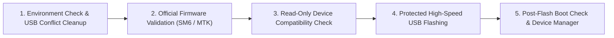

<div align="center">
  <a href="https://www.suntekai.com">
    <picture>
      <source media="(prefers-color-scheme: dark)" srcset="https://raw.githubusercontent.com/SUNTEK-Official/.github/main/profile/assets/logo-dark.png">
      <source media="(prefers-color-scheme: light)" srcset="https://raw.githubusercontent.com/SUNTEK-Official/.github/main/profile/assets/logo-light.png">
      
    </picture>
  </a>

  <h1>SUNTEK MTK Flash Studio for macOS</h1>

  <p>
    <strong>Official macOS Firmware Flashing &amp; Device Management Studio for SUNTEK MediaTek Terminals (including SM6)</strong> &middot; <em>Enjoy Smarter Service</em><br>
    Self-contained Universal 2 (<code>Apple Silicon</code> + <code>Intel</code>) desktop tool by <strong>SUNTEK Technology Co., Ltd.</strong>
  </p>

  <p>
    <a href="./LICENSE"></a>
    <a href="https://github.com/SUNTEK-Official/suntek-mtk-flash-studio/releases"></a>
    
    
    <a href="mailto:support@suntekai.com"></a>
  </p>

  <p>
    <a href="#overview--guided-workflow">Overview</a> &nbsp;&bull;&nbsp;
    <a href="#key-features">Features</a> &nbsp;&bull;&nbsp;
    <a href="#official-downloads--sha-256-verification">Downloads</a> &nbsp;&bull;&nbsp;
    <a href="#quick-start-guide">Quick Start</a> &nbsp;&bull;&nbsp;
    <a href="#troubleshooting--faq">FAQ</a> &nbsp;&bull;&nbsp;
    <a href="#support">Support</a>
  </p>

  
</div>

---

## Overview & Guided Workflow

**SUNTEK MTK Flash Studio** (formerly *SUNTEK SM6 Flash Wizard*) is the official macOS desktop service workstation for upgrading, restoring, managing, and verifying **SUNTEK MediaTek commercial terminals**, with full out-of-the-box support for **SUNTEK SM6** (`MT6768` / `MT8786`) handheld Smart POS terminals over USB and LAN ADB. Designed for field engineers, distributors, and service centers, it bundles all required runtime components inside a signed macOS `.app` installer with zero Homebrew or driver setup required.



> [!NOTE]
> Application source code and proprietary servicing tools are the intellectual property of **SUNTEK Technology Co., Ltd.** This public repository hosts official documentation and SHA-256 verified signed macOS `.dmg` installers distributed exclusively via [**GitHub Releases**](https://github.com/SUNTEK-Official/suntek-mtk-flash-studio/releases).

---

## Key Features

- **Native Universal 2 macOS Application**: Supports both **Apple Silicon** and **Intel** (`x86_64`) Macs running **macOS 12.0 (Monterey)** or newer, signed with an Apple Developer ID certificate.
- **Zero-Install Self-Contained Runtime**: All runtime engines (`Python 3.12` + `libusb` + `mtkclient` + `adb`), USB userspace drivers, and post-flash verification tools are embedded inside the application bundle.
- **14 Built-in Languages (Auto-Detect & Live Switching)**: Automatically follows the macOS system language or switches live from the sidebar globe menu or **Settings** (`Cmd + ,`) across **14 languages**:
  - `English` (`en`), `Simplified Chinese` (`zh-Hans`), `Traditional Chinese` (`zh-Hant`), `Spanish` (`es`), `French` (`fr`), `German` (`de`), `Russian` (`ru`), `Portuguese` (`pt`), `Italian` (`it`), `Romanian` (`ro`), `Turkish` (`tr`), `Polish` (`pl`), `Dutch` (`nl`), and `Indonesian` (`id`).
- **Pre-Flash USB Conflict Detector**: Detects background apps that commonly hijack POS USB ports (`Android Studio`, `Parallels Desktop`, `VMware`, `VirtualBox`, `Android File Transfer`, `scrcpy`, `hdc`, `adb`) and offers one-click cleanup.
- **Strict Hardware & Firmware Safety Guards**:
  - Validates official SUNTEK MediaTek / **SM6** factory firmware packages offline (automatically rejecting incompatible files or OTA archives), checks for pre-flash file modifications, and supports optional **MD5 `.txt` / `.md5` integrity verification**.
  - Performs a mandatory read-only device compatibility check, **eMMC storage lifecycle check**, and **USB link speed diagnostic** before unlocking firmware writes.
  - Hard-locks 25 critical calibration/security partitions (`nvram`, `nvdata`, `nvcfg`, `protect1/2`, `persist`, `seccfg`, `proinfo`, `frp`, etc.) across both **Upgrade System (Keep Data · Recommended)** and **Factory Reset / Clean Reinstall** modes.
- **Built-in ADB Device Manager & LAN Discovery**: Manage customer APKs, browse/transfer device files, capture screenshots/logcat, discover wireless ADB devices automatically via **macOS Bonjour (`dnssd`) & LAN scan**, and trigger 1-click power-off to enter Preloader/BROM flashing mode.
- **High-Speed Flashing, History & Engineering Tools**: Displays overall component fraction (`X/N`), transfer speed, and ETA, plus operation history records, a session-locked engineering diagnostics view, and an interactive **15-Second Power Reset Guide**.
- **Advanced Service Options**: Collapsed **Advanced Options** in **Settings** (`Cmd + ,`) allow enabling strict per-packet USB checksum verification for cable troubleshooting or loading a validated custom MediaTek Download Agent (`.bin`).

---

## What's New in v2.1.0

- **Unified Family Rebrand (Full SM6 Support Retained)**: Renamed from *SUNTEK SM6 Flash Wizard* to **SUNTEK MTK Flash Studio** with a refreshed indigo/amber family icon and unified macOS Studio sidebar/toolbar layout, while maintaining full **SUNTEK SM6** (`MT6768` / `MT8786`) firmware & hardware compatibility.
- **Built-in ADB Device Manager & Bonjour LAN Discovery**: Added dedicated **App Manager**, **File Manager**, **Logcat / Screenshot**, 1-click **Power Off for Flashing**, and automatic macOS Bonjour wireless ADB discovery.
- **Operation History & Session-Locked Engineering View**: Added searchable flash/diagnostics history logs and a protected engineering diagnostics tab alongside the 5-step guided wizard.
- **Quick 14-Language Globe Switcher & Pre-Flash File Guard**: Added an instant sidebar language switcher and automatic pre-flash check if the selected firmware archive has been modified or moved.

---

## Official Downloads & SHA-256 Verification

<table>
  <tr>
    <td align="center" width="32%">
      <a href="https://www.suntekai.com/products/suntek-handheld-pos-terminal-sm6/">
        
      </a>
    </td>
    <td>
      <h3>SUNTEK MTK Flash Studio v2.1.0 (macOS Universal 2)</h3>
      <p>Download the signed disk image and checksum manifest directly from the <a href="https://github.com/SUNTEK-Official/suntek-mtk-flash-studio/releases/latest"><b>Latest GitHub Release</b></a>.</p>
      <ul>
        <li><code>SUNTEK-MTK-Flash-Studio-2.1.0.dmg</code> &mdash; Signed macOS 12.0+ Universal 2 installer (Apple Silicon + Intel)</li>
        <li><code>SHA256SUMS.txt</code> &mdash; Official SHA-256 verification digest</li>
      </ul>
    </td>
  </tr>
</table>

Always verify the downloaded `.dmg` checksum in macOS Terminal before installation:

```bash
shasum -a 256 -c SHA256SUMS.txt
```

### Installation

1. Double-click `SUNTEK-MTK-Flash-Studio-2.1.0.dmg` to mount the disk image.
2. Drag **SUNTEK MTK Flash Studio.app** into your **Applications** folder.
3. Launch **SUNTEK MTK Flash Studio** from **Applications** (the interface automatically matches your macOS system language, or use the sidebar globe menu / gear icon to choose any of the 14 built-in languages).

---

## Quick Start Guide

1. **Step 1 — Environment Check**: Confirm bundled components pass self-check and close any USB-holding tools (`Android Studio`, `Parallels`, `VMware`, `Android File Transfer`, `scrcpy`). Plug the USB cable directly into a Mac port rather than an unpowered USB hub.
2. **Step 2 — Select Firmware & Mode**: Drag and drop your official SUNTEK MediaTek / SM6 factory firmware `.zip` (or extracted folder). Choose **Upgrade System (Keep Data)** or **Factory Reset / Clean Reinstall**.
3. **Step 3 — Read-Only Compatibility Check**:
   - Unplug USB from the POS and confirm the screen stays off for at least 5 seconds.
   - Click the blue **Wait & Check Device Compatibility (Read-Only)** button **first**.
   - Without holding any buttons on the POS, plug the USB cable into your Mac.
   - When the check succeeds, **unplug the USB cable** so the POS powers off completely.
4. **Step 4 — Prepare & Flash**: Run **Prepare Files**, optionally inspect **Preview Plan**, then click **Start Wire Flash**, confirm `FLASH-MTK` **before** plugging in the powered-off POS, and wait until writing finishes (`100%`). Do **not** unplug USB or sleep your Mac during writing.
5. **Step 5 — Boot & Post-Flash Verification**: Unplug the USB cable, press the Power button briefly to boot into Android (first boot takes 1–3 minutes), enable **USB Debugging** if desired, and run **Verify Booted POS** to confirm system integrity and cellular baseband health.

---

## Troubleshooting & FAQ

<details>
<summary><b>The POS only shows a charging battery icon or does not respond when plugged in</b></summary>
<p>Ensure you click the blue/red wait button on Mac <b>before</b> connecting USB, and verify the POS was unplugged and completely powered off for at least 5 seconds. If it still enters charging mode, unplug the cable, hold <b>Vol-</b> (or both <b>Vol+ &amp; Vol-</b>), and reconnect USB while the studio is waiting.</p>
</details>

<details>
<summary><b>The POS screen stays black after an interrupted connection</b></summary>
<p>Unplug the USB cable first (critical so USB power does not keep the power controller latched), click <b>15s Reset</b> in the top toolbar, hold the POS <b>Power</b> button continuously for 15 seconds, pause 1 second, and press Power normally to boot or retry flashing.</p>
</details>

<details>
<summary><b>Why did the studio block my device or firmware package?</b></summary>
<p>For hardware safety, SUNTEK MTK Flash Studio enforces strict read-only device and firmware compatibility checks. OTA update archives, mismatched models, or locked/custom configurations are blocked before any write occurs. Contact SUNTEK Support for the matching factory package.</p>
</details>

<details>
<summary><b>macOS warns about opening an app downloaded from the Internet</b></summary>
<p>Always verify the `.dmg` with `shasum -a 256 -c SHA256SUMS.txt`. The application is Developer-ID signed; if macOS prompts on first launch from Downloads, copy it to <b>Applications</b> first and open it via Control-click -&gt; <b>Open</b>.</p>
</details>

---

## Support

- **Technical Support & Service**: [support@suntekai.com](mailto:support@suntekai.com)
- **Official Website**: [www.suntekai.com](https://www.suntekai.com)

---

<div align="center">
  
  <br><br>
  <strong>SUNTEK Technology Co., Ltd.</strong> &mdash; <em>Smart Commercial Terminal Hardware Manufacturer Since 2010</em><br>
  <sub>80+ Export Countries &middot; 5,000,000+ Terminals Shipped &middot; ISO 9001 / ISO 27001 / CE / RoHS</sub>
</div>
